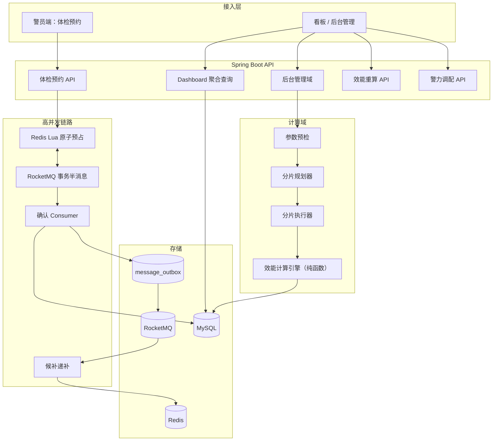
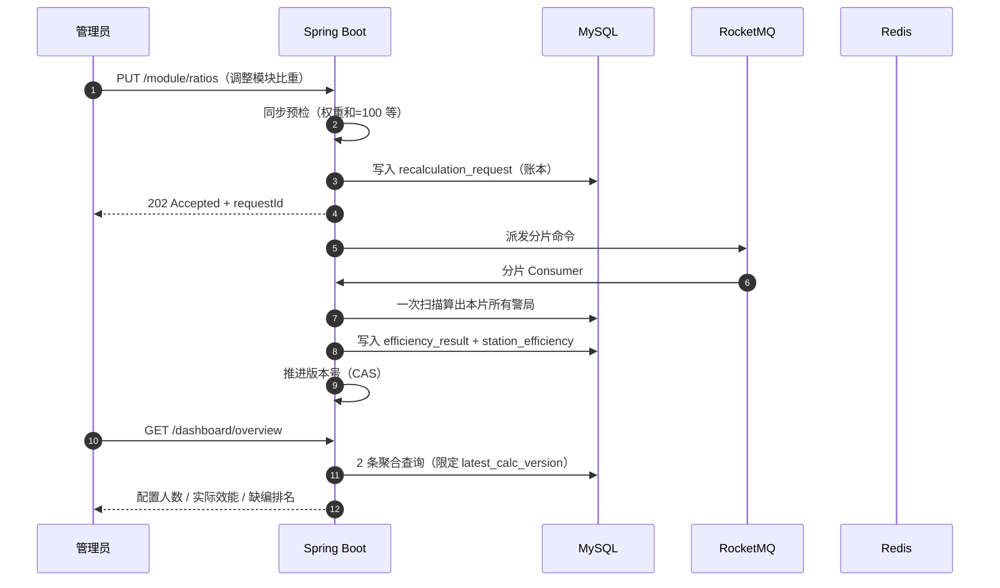

# 警力合理配置规划平台（后端）

面向**警务人力资源配置与效能评估**场景的 Java 后端项目。系统以「效能计算」为主线：后台调整勤务模块比重、核定配置人数、效能因素（年龄/性别）权重后，平台异步重算全局警力效能并驱动看板呈现；同时保留了原开源项目的高并发抢占能力，改造为**警员体检预约**模块（500 并发抢 70 个名额），并与效能计算形成闭环。

> 本仓库基于开源项目 [`lab-resource-reservation-platform`](https://github.com/Fragmentaim/lab-station-allocation-platform) 改造而来。原项目是「实验室公共设备与热门时段抢占」的预约系统，保留了它的冷热链路分离、事务半消息、Redis Lua 原子预占、Outbox 可靠事件与双重幂等机制，并将业务语义整体迁移到警务场景。

## 一句话定位

**高并发体检预约是入口，警力效能计算是主线，后台配置是驱动源。**

- 体检预约 500 并发抢 70 名额 → 高并发链路（Redis Lua + RocketMQ + Outbox）
- 体检结论录入 → 有效警力变化 → 触发所在警局**增量重算**
- 后台改模块比重 / 配置人数 / 因素权重 → 触发**全量重算**（分片并行）
- 重算结果 → 看板展示配置人数、实际效能、模块占比与人数分布

## 项目亮点

### 亮点一：异步解耦与 202 Accepted

批量重算如果同步执行，几十个警局的计算会把 HTTP 线程池和数据库连接池同时打满。平台的做法是：

1. **同步预检**（`EfficiencyPrecheckService`）：权重和必须为 100、年龄段可解析、性别必须覆盖 MALE/FEMALE、配置人数非负 —— 不通过直接 400，绝不进入异步阶段；
2. **同步落账本**（`recalculation_request`）：写入重算请求并返回 `202 Accepted` + `requestId`；
3. **后台异步分片派发**（`RecalculationShardPlanner` + RocketMQ）：把警局切成若干分片，每片一条消息。

预检放在同步阶段是刻意的：预检要挡住的问题一旦进入异步阶段，就变成「已经在跑的批次突然失败」，比同步失败难排查得多。

**读放大塌缩**是这一层的关键设计。如果「每个警局一条消息、每条消息查一次全表」，N 个警局就是 N 次全表扫描。平台采用「每分片一条消息、每片只扫一次表在内存里算多个警局」，把 N 次全表扫描塌缩为 `ceil(N / shardSize)` 次，**读放大与警局数无关**（默认分片 20：200 个警局 → 10 次扫描）。

### 亮点二：极致可靠性（Outbox + 双重幂等）

**Transactional Outbox**：业务结果事件与业务数据在**同一个数据库事务**中提交（`message_outbox` 表），由调度器统一重试投递。彻底消除「数据库成功但消息丢失」的双写窗口。

**双重幂等**：

| 层级 | 机制 | 作用 |
| --- | --- | --- |
| 第一道 | `insertProcessingIgnore` 唯一索引去重表 | 抵御 RocketMQ 至少一次投递的重复消费 |
| 第二道 | 进程内状态机 CAS（条件更新） | 抵御并发重复处理同一业务实体 |

两道幂等职责不同：第一道解决「同一条消息被投递多次」，第二道解决「同一业务实体被多个流程同时推进」。

### 亮点三：并发控制与资源预占

体检预约是典型的「500 并发抢 70 名额」：

1. **Redis Lua 原子预占**：一次脚本内完成「快照校验 + 窗口校验 + 一人一档校验（`HEXISTS officers officerId`）+ 扣减库存 + 记录 `PRE_RESERVED` 状态」。失败请求在 Redis 层就被挡掉，**根本不进入 MySQL**；
2. **RocketMQ 事务半消息**：Lua 预占作为本地事务，只有预占成功才提交消息；Redis 结果未知时交由 Broker 回查；
3. **MySQL 条件原子更新**：`UPDATE exam_slot SET remain_quota = remain_quota - 1 WHERE id = ? AND remain_quota >= 1`，受影响行数为 0 即判定库存耗尽。Redis 与 MySQL 两道闸门都基于「剩余量 ≥ 需求量」的同一判据，不会给出相互矛盾的结论。

**候补队列**：名额被取消时，通过 Outbox 投递延迟消息，触发 `ExamWaitingService.promote`，用 Lua 原子完成「出队 + 扣名额 + 占警员位」，保证两个并发释放事件不会把同一个名额派给两个人。排队顺序由 Redis ZSet 承载（score = 单调递增的入队序号），MySQL `exam_waiting` 表作为持久化快照。

## 系统架构



架构细节、异常窗口说明与一致性矩阵见 [docs/architecture.md](docs/architecture.md)。

## 效能计算链路



**计算公式**（`EfficiencyCalcEngine`，纯函数，无 IO）：

```
个体效能分 officerScore = baseScore(100)
                         × Σ(匹配年龄段的权重 / 100)
                         × Σ(匹配性别的权重 / 100)
                         × 体检伤病调整系数

模块效能 moduleScore = 配置人数 × 模块比重/100 × 模块内平均个体效能分
警局效能 stationEfficiency = Σ moduleScore
有效警力 effectiveHeadcount = 体检合格(PASS 或未体检)且在编的人数
实际效能 actualEffectiveness = 有效警力 / 配置人数
缺编人数 shortage = 配置人数 - 有效警力
```

把算法做成纯函数是可测试性的关键：算法能脱离数据库与 MQ 单独单测，也能通过「同一批输入必然得到同一批输出」证明计算是**可重放**的（重放历史版本可对比调整前后的效能变化）。

## 业务能力

| 需求（来自 read.txt） | 实现 |
| --- | --- |
| 警局配置人数展示界面 | `GET /dashboard/stations`、`GET /dashboard/stations/{stationId}` |
| 警局实际效能展示 | `GET /dashboard/overview`、`GET /dashboard/stations`（`actualEffectiveness` / `stationScore`） |
| 配置人数详情（各模块占比及人数分布） | `StationOverviewVO.modules[]`（`ModuleBreakdownVO`） |
| 后台各模块增删改查及比重设置 | `/module`（增删改查）、`PUT /module/ratios`（比重） |
| 效能因素（年龄、性别）比重设置 | `/factor`（`PUT /factor`、`PUT /factor/{id}/status`） |
| 各警局人员信息管理 | `/officer`（增删改查 + 分页查询） |
| 警员体检预约（高并发） | `/exam`（含候补队列、体检结论录入） |

## API 一览

所有接口返回统一结构 `Result<T>`：`{ code, message, data }`。

### 看板与效能

| 方法 | 路径 | 说明 |
| --- | --- | --- |
| GET | `/dashboard/overview` | 全局总览：警局数、配置人数、有效警力、实际效能、缺编 Top N |
| GET | `/dashboard/stations` | 警局配置人数与实际效能列表（可按 `district` 过滤） |
| GET | `/dashboard/stations/{stationId}` | 单警局详情，含各模块占比与人数分布 |
| POST | `/efficiency/recalculate` | 触发重算，返回 **202 Accepted** + `requestId` |
| GET | `/efficiency/requests/{requestId}` | 查询重算批次状态 |
| GET | `/efficiency/precheck` | 只做预检不落库，用于后台表单实时校验 |

### 后台管理

| 方法 | 路径 | 说明 |
| --- | --- | --- |
| GET | `/module/list` | 勤务模块列表 |
| POST | `/module` | 新增勤务模块 |
| PUT | `/module` | 修改勤务模块 |
| DELETE | `/module/{id}` | 删除勤务模块 |
| PUT | `/module/ratios` | 批量设置模块比重（触发全量重算） |
| GET | `/station/headcount/list?stationId=` | 某警局各模块配置人数 |
| PUT | `/station/headcount` | 调整配置人数（触发该警局增量重算） |
| GET | `/factor/list?factorType=` | 效能因素列表（`AGE` / `GENDER`） |
| PUT | `/factor` | 批量设置因素权重（触发全量重算） |
| PUT | `/factor/{id}/status?status=` | 启用/停用某条因素 |
| GET | `/officer/list?stationId=` | 某警局警员列表 |
| GET | `/officer/page` | 警员分页（`stationId` / `moduleId` / `keyword`） |
| POST | `/officer` | 新增警员 |
| PUT | `/officer` | 修改警员 |
| DELETE | `/officer/{id}` | 删除警员 |
| GET | `/station/list` `/station/page` `/station/{id}` | 警局查询 |
| POST/PUT/DELETE | `/station` `/station/{id}` | 警局增删改 |
| GET | `/admin/dashboard/overview` | 管理端统计 |

### 体检预约

| 方法 | 路径 | 说明 |
| --- | --- | --- |
| POST | `/exam/appointments` | 预约体检（热门时段返回 **202 Accepted**） |
| GET | `/exam/requests/{requestId}` | 查询预约请求状态 |
| PUT | `/exam/appointments/{id}/cancel` | 取消预约（回补名额 + 触发候补递补） |
| GET | `/exam/slots/{slotId}/waiting-count` | 候补队列长度 |
| GET | `/exam/batches` | 已放号的体检批次 |
| GET | `/exam/batches/{batchId}/slots` | 批次下的体检时段 |
| GET | `/exam/appointments/page` | 预约记录分页 |
| POST | `/exam/appointments/{id}/result` | 录入体检结论（`PASS`/`FAIL`/`INJURED`），触发增量重算 |

### 警力调配与基础能力

| 方法 | 路径 | 说明 |
| --- | --- | --- |
| POST | `/allocation` | 提交调配申请（热门时段 **202 Accepted**） |
| GET | `/allocation/requests/{requestId}` | 查询调配请求状态 |
| GET | `/allocation` `/allocation/page` `/allocation/{id}` | 调配记录查询 |
| PUT | `/allocation/{id}/check-in` | 签到 |
| PUT | `/allocation/{id}/cancel` | 取消调配 |
| POST | `/auth/login` `/auth/register` `/auth/logout` | 登录/注册/登出 |
| GET | `/auth/me` | 当前用户 |
| PUT | `/auth/password` | 修改密码 |
| GET | `/system/health` | 健康检查 |

---

## 一致性设计

| 问题 | 处理方式 |
| --- | --- |
| 客户端重复点击 | `Idempotency-Key` 归一化为稳定 `requestId`，同一请求不重复扣库存 |
| 同一警员重复预约同一时段 | Redis `officers` Hash 一人一档；MySQL 唯一键 `uk_allocation_officer_slot_active` / 体检唯一索引再次兜底 |
| Redis 并发扣减 | Lua 脚本原子执行校验、去重和扣减 |
| MQ 重复投递 | 请求账本唯一索引 + `insertProcessingIgnore` 幂等消费 |
| MySQL 超卖 | `remain_quota >= need` 条件更新，受影响行数为 0 即拒绝 |
| 数据库成功但结果消息未发出 | 业务结果与 Outbox 同事务提交，调度器重试发布 |
| 消费端业务拒绝 | 写入 `REJECTED` 终态并 ACK；结果事件只释放一次 Redis 预占 |
| Redis 暂时不可用 | 热门链路快速失败，普通链路不受影响 |
| 热点缓存缺失 | 热门请求返回「系统准备中」，不降级为高并发直打 MySQL |
| 重算读到半新半旧数据 | 版本号 CAS 推进，看板只读 `latest_calc_version` 对应的结果 |

Redis 只保存热门时段的临时并发状态，MySQL 始终是最终业务事实来源。

## 性能测试（压测规格）

测试场景：**500 并发抢占 70 个体检名额**（放号瞬间）。

| 项目 | 取值 |
| --- | --- |
| 并发用户数 | 500 |
| 名额总数 | 70 |
| 时段类型 | HOT（放号瞬间） |
| 施压方式 | 同一台 ECS（4 vCPU / 8 GiB）、VPC 内网 |
| 请求头 | `Idempotency-Key` 每请求唯一 |
| 观察指标 | 受理接口 TPS / 平均响应时间 / P99 / 最终确认数 / 超卖数 |

**验收标准**：

1. **不超卖**：最终确认的预约数 **恰好 ≤ 70**，`exam_slot.remain_quota` **不为负**；
2. **不丢单**：`PENDING` + `CONFIRMED` + `REJECTED` + `WAITING` 之和 = 500；
3. **一警一档**：同一 `officer_id` 在同一 `slot_id` 下只有一条有效预约；
4. **幂等生效**：同一 `Idempotency-Key` 重复提交 100 次，只产生一条预约记录；
5. **受理不阻塞**：热门路径的 P99 响应时间不随并发数线性恶化（202 立即返回）。

> 压测数字**不复用开源项目**，需按上述规格在目标环境实测后填入本表；本仓库只固定规格与验收口径。

## 代码导航

```text
backend/src/main/java/com/fragment/policeforce
├─ efficiency              # 效能计算主线
│  ├─ api                  # 重算触发、状态查询、预检接口
│  ├─ service              # 计算引擎（纯函数）、预检、分片规划、分片执行
│  ├─ messaging            # 分片命令发布与消费
│  └─ persistence          # 重算账本、分片、结果、警局效能 Mapper
├─ exam                    # 体检预约（高并发）
│  ├─ api                  # 预约、取消、候补、批次、体检结论
│  ├─ service              # 资格校验、路由、确认、结果、取消、候补递补、名额分配
│  ├─ redis                # Lua 状态机：初始化/受理/完成/释放/入队/递补
│  ├─ messaging            # 事务半消息、命令与结果事件、消费者
│  └─ persistence          # 批次、时段、预约、请求账本、候补 Mapper
├─ admin                   # 后台管理域
│  ├─ api                  # 模块、警员、因素、配置人数
│  └─ service              # CRUD + 比重/权重设置 + 触发重算
├─ dashboard               # 看板聚合
│  ├─ persistence          # 2 条查询完成全量聚合，规避 N+1
│  └─ service / vo
├─ allocation              # 警力调配（保留自开源项目）
│  ├─ api / service / messaging / redis / persistence / reminder / support
├─ common
│  ├─ outbox               # Transactional Outbox：入队、发布、消费适配
│  ├─ auth                 # JWT 与登录上下文
│  ├─ audit                # 管理员操作审计
│  └─ redis / util / exception
└─ controller              # 警局、时段、用户、字典、通知、健康检查
```

建议阅读顺序：

1. [`EfficiencyCalcEngine`](backend/src/main/java/com/fragment/policeforce/efficiency/service/EfficiencyCalcEngine.java)：效能算法本体（纯函数）。
2. [`RecalculationService`](backend/src/main/java/com/fragment/policeforce/efficiency/service/RecalculationService.java)：预检 → 落账本 → 202 → 派发分片。
3. [`RecalculationShardPlanner`](backend/src/main/java/com/fragment/policeforce/efficiency/service/RecalculationShardPlanner.java)：读放大塌缩的分片策略。
4. [`RecalculationShardExecutor`](backend/src/main/java/com/fragment/policeforce/efficiency/service/RecalculationShardExecutor.java)：分片内一次扫描算多个警局。
5. [`ExamRedisService`](backend/src/main/java/com/fragment/policeforce/exam/redis/ExamRedisService.java)：Lua 状态机（预占/完成/释放/候补递补）。
6. [`ExamTransactionListener`](backend/src/main/java/com/fragment/policeforce/exam/messaging/ExamTransactionListener.java)：事务半消息本地事务与 Broker 回查。
7. [`ExamConfirmationService`](backend/src/main/java/com/fragment/policeforce/exam/service/ExamConfirmationService.java)：MySQL 最终确认 + 双重幂等。
8. [`ExamWaitingService`](backend/src/main/java/com/fragment/policeforce/exam/service/ExamWaitingService.java)：候补队列与原子递补。
9. [`DashboardAggregateMapper`](backend/src/main/java/com/fragment/policeforce/dashboard/persistence/DashboardAggregateMapper.java)：看板聚合查询。

## 快速启动

环境要求：Docker Compose，或本机 Java 17 + MySQL 8 + Redis 7 + RocketMQ 4.9。

```powershell
Copy-Item .env.example .env
docker compose --env-file .env up -d --build
```

启动后：

- 后端地址：`http://localhost:8081`
- 健康检查：`GET http://localhost:8081/system/health`
- 初始化 SQL：`backend/src/main/resources/sql/police-force-init.sql`（compose 已自动挂载）

`.env.example` 仅包含示例值；正式部署前请替换数据库密码和 `JWT_SECRET`。

## 本地测试

```powershell
cd backend
mvn test
```

测试覆盖：效能计算引擎（纯函数精确断言）、参数预检（各类拒绝分支）、分片规划（读放大塌缩、超限合并不丢警局）、体检资格校验、体检名额分配（最大余额法）、Redis 状态机、事务半消息回查、确认与结果收敛、Outbox 幂等。

需要真实 Redis 的集成测试通过环境变量开启：

```powershell
$env:RUN_REDIS_INTEGRATION_TESTS = "true"
mvn test
```

GitHub Actions 会执行 Java 测试、Compose 配置校验和敏感信息扫描。

## 技术栈

Java 17、Spring Boot 4、MyBatis-Plus、MySQL 8、Redis、Redisson、RocketMQ、Spring Cloud Stream、JWT、Maven、Docker Compose
