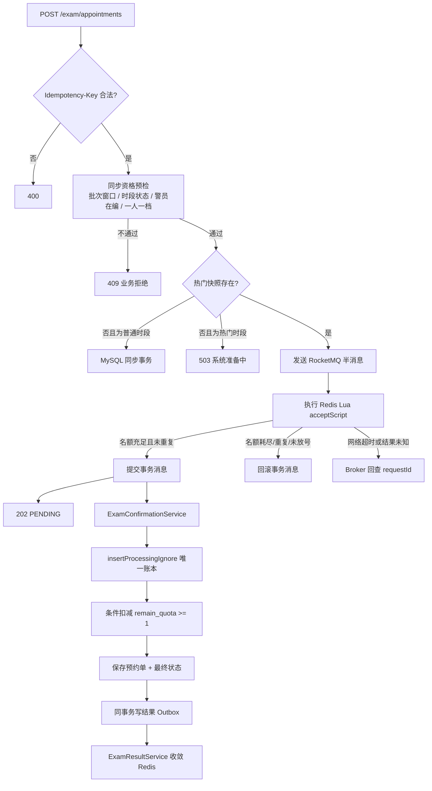
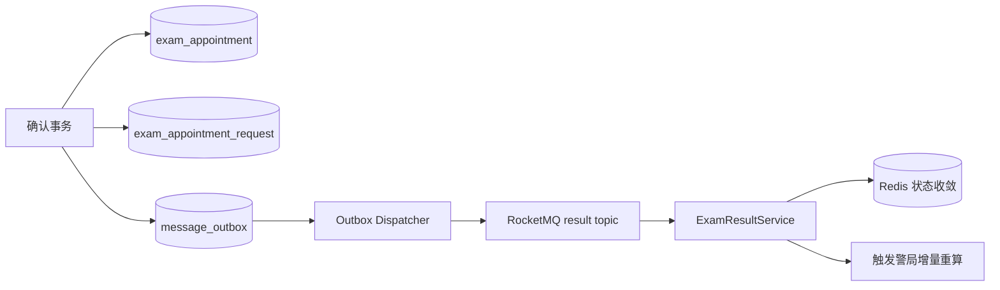

# 警力合理配置规划平台 · 架构说明

本文分三部分：**计算主线**（效能重算）、**高并发链路**（体检预约）、**通用可靠性设施**（Outbox / 幂等 / 审计）。

---

# 第一部分 · 效能计算主线

## 1. 业务主线

后台的每一次配置变更都会影响效能结论，因此所有变更都遵循同一条路径：

```
后台变更 → 同步预检 → 落重算账本 → 202 Accepted → 分片异步重算 → 版本推进 → 看板刷新
```

| 变更类型 | 触发范围 | 触发来源常量 |
| --- | --- | --- |
| 勤务模块比重调整 | 全量 | `MODULE_RATIO` |
| 效能因素权重调整 | 全量 | `FACTOR_WEIGHT` |
| 某警局配置人数调整 | 单警局（增量） | `HEADCOUNT` |
| 体检结论录入 | 所属警局（增量） | `EXAM_RESULT` |
| 手工触发 | 按 scopeType | `MANUAL` |

**增量 vs 全量**：单警局的变更只重算该警局，不触碰其它警局的结果，也不推进全局版本号；全量变更才启动分片流水线并推进 `latest_calc_version`。这样看板在增量期间读到的仍然是「上一版本的全局一致快照 + 该警局的新结果」。

## 2. 为什么预检必须在同步阶段

`EfficiencyPrecheckService` 的检查项：

1. 因素表非空；
2. 年龄维度、性别维度均已配置；
3. 各维度权重和 **精确等于 100**（否则会出现「有的档位权重为 0、有的超过 100」的病态分布）；
4. 单条权重落在 0-100（防止负分）；
5. 年龄段取值可解析（`25以下` / `25-35` / `55以上`）；
6. 性别维度必须同时覆盖 `MALE` 与 `FEMALE`（否则部分警员匹配不到任何配置）。

预检失败直接返回 400，**不写账本、不发消息**。理由是：这些配置错误一旦进入异步阶段，就会表现为「已经跑起来的批次中途失败」，需要回查批次日志才能定位；而同步 400 会把错误直接指回发起变更的那一次表单提交。

## 3. 分片：读放大的塌缩

批量重算惊群的本质是**读放大**。如果按警局粒度派发：

```
200 个警局 → 200 条消息 → 200 次全表扫描 → 数据库被读垮
```

平台采用分片：

```
200 个警局 / 分片大小 20 → 10 条消息 → 10 次全表扫描 → 每次扫描在内存里算 20 个警局
```

**读放大从 O(警局数) 降到 O(警局数 / 分片大小)，与警局总数解耦。**

分片大小的取舍：

| 分片大小 | 全表扫描次数 | 单片耗时 | 失败重投代价 |
| --- | --- | --- | --- |
| 5 | 多 | 短 | 小 |
| 20（默认） | 中 | 中 | 中 |
| 100 | 少 | 长 | 大（一片失败要重算 100 个警局） |

`maxShards` 是防止警局数量失控时把 MQ 打满的保护。**超限时剩余警局并入最后一个分片，而不是丢弃** —— 丢弃会让这些警局的效能永远停留在旧版本，这是一个静默的数据正确性 bug，比「多发几条消息」严重得多。

## 4. 分片内的一致性

一个分片内的执行顺序：

```
一次扫描 → 内存计算本片所有警局 → 写入 efficiency_result → 更新 station_efficiency → 推进版本号（CAS）
```

版本号推进使用条件更新（CAS），保证并发分片不会把版本号推回旧值。看板聚合查询只读 `latest_calc_version` 对应的结果，避免读到「部分警局是新版本、部分还是旧版本」的中间态。

## 5. 看板聚合：规避 N+1

`DashboardAggregateMapper` 只发 **2 条查询**：

1. `selectStationAggregates` —— 一次拿到所有警局的配置人数、有效警力、效能分、缺编；
2. `selectModuleBreakdowns` —— 一次拿到所有警局 × 所有模块的占比与人数分布（限定 `latest_calc_version`）。

然后在内存里按 `stationId` 分组。避免了「N 个警局 → N 次详情查询」的 N+1 读放大。

---

# 第二部分 · 高并发链路（体检预约）

## 6. 冷热路由

| 场景 | 执行方式 | 返回语义 |
| --- | --- | --- |
| 普通体检时段 | MySQL 本地事务同步创建预约 | HTTP 200，`CONFIRMED` |
| 已预热热门时段 | RocketMQ 事务半消息 + Redis Lua 预占 + MQ 异步确认 | HTTP 202，`PENDING` |
| 热门时段未预热 | 拒绝请求，不降级直打数据库 | HTTP 503 |
| Redis 不可用 | 热门链路快速失败；普通链路继续工作 | HTTP 503 / 200 |

请求入口保持统一：`POST /exam/appointments`。服务端根据时段类型和热门快照选择执行链路，前端不需要维护两个业务接口。

## 7. Redis 数据结构与 Lua 状态机

```text
exam:hot:v2:snapshot:{slotId}    Hash    # 时段状态、批次、开放与结束时间快照
exam:hot:v2:stock:{slotId}       String  # 当前可预占名额
exam:hot:v2:officers:{slotId}    Hash    # officerId -> requestId，一人一档
exam:hot:v2:request:{requestId}  Hash    # 请求参数与 PRE_RESERVED/终态
exam:waiting:{slotId}            ZSet    # 候补队列，score = 入队序号
```

| Lua 脚本 | 职责 | 原子保证 |
| --- | --- | --- |
| `initializeScript` | 预热时段快照与库存 | 快照与库存同时就绪 |
| `acceptScript` | 校验快照 + 窗口 + 一人一档 + 扣库存 + 写 `PRE_RESERVED` | 校验与扣减不会分离 |
| `completeScript` | 收敛请求状态；`REJECTED` 时释放占位并回补库存 | 库存只回补一次 |
| `releaseScript` | 取消预约时释放占位并回补名额 | 释放与回补原子 |
| `enqueueWaitingScript` | 候补入队（score = 单调递增序号） | 入队顺序确定 |
| `promoteWaitingScript` | 候补递补：出队 + 扣库存 + 占警员位 | 同一名额不会被派给两人 |

请求线程只读取已经准备好的热点状态，不负责等待、加锁或重建。

## 8. 一次热门体检预约



### 为什么是「先半消息，再执行 Lua」

如果先扣 Redis 再普通发送 MQ，会出现「Redis 已扣减，但应用在消息发送前宕机」的窗口，需要额外扫描和补偿。事务半消息把两个动作绑定为一个可回查流程：

1. **半消息发送失败**：Lua 尚未执行，不产生名额变化；
2. **Lua 明确成功**：提交消息，交给 RocketMQ 可靠投递；
3. **Lua 明确拒绝**：回滚半消息，不进入消费端；
4. **Lua 响应未知**：不贸然提交或回滚，由 Broker 根据 Redis 中的 `requestId` 状态回查。

## 9. 候补队列与递补

名额释放时的处理顺序：

```
取消预约 → MySQL 恢复名额 → Redis 释放占位并回补名额
        → 同事务写 Outbox（延迟消息） → 调度器投递延迟消息
        → ExamWaitingService.promote → Lua promoteWaitingScript 原子递补
```

为什么用延迟消息而不是直接同步递补？取消请求是用户同步操作，不应该承担「找人、占位、落库」的耗时；而且递补失败时需要独立重试能力。

**递补的原子性**由 Lua 保证：出队 + 扣库存 + 占警员位在一次脚本内完成，两个并发的释放事件不会把同一个名额派给两个候补。MySQL 侧还有第二道闸门：`promoteIfWaiting` 条件更新保证每条候补记录只被递补一次。

## 10. 体检结论驱动的闭环

```
体检结论 PASS   → 有效警力 +1 → 该警局增量重算 → 实际效能上升
体检结论 FAIL   → 有效警力 -1 → 该警局增量重算 → 实际效能下降
体检结论 INJURED→ 有效警力不变，但个体效能分按伤病系数下调
```

这一步是整个平台的**业务闭环**：高并发体检不只是「抢名额」，抢到的体检结果直接改变警力效能，进而改变体检名额的分配依据（`ExamQuotaAllocator` 按缺编比例分配名额），形成自我校正。

---

# 第三部分 · 通用可靠性设施

## 11. Outbox 的职责

Outbox 不参与入口削峰，它解决的是数据库与后续消息的**可靠双写**：



如果进程在数据库提交后、消息发送前宕机，Outbox 记录仍在；服务恢复后继续发布，不会出现「预约成功但后续事件永久丢失」。

## 12. 双重幂等

RocketMQ 提供至少一次投递，因此「消息可能重复」是正常情况。消费端使用两层约束：

| 层级 | 机制 | 抵御的场景 |
| --- | --- | --- |
| 第一道 | 唯一索引 + `insertProcessingIgnore` 去重表 | 同一条消息被投递多次 |
| 第二道 | 进程内状态机 CAS（条件更新） | 同一业务实体被多个流程同时推进 |

两道幂等职责不同，缺一不可：第一道解决「消息重复」，第二道解决「状态并发推进」。例如候补递补，第一道防止重复投递导致重复递补，第二道 `promoteIfWaiting` 防止两个不同的释放事件同时递补同一条候补记录。

重复消息发现账本已是终态时直接 ACK；技术异常抛出，让 Binder 和 RocketMQ 重试。

## 13. 数据库最终确认事务

同一个 MySQL 本地事务完成：

1. 插入 `PROCESSING` 请求账本（`insertProcessingIgnore`）；
2. 重新校验批次窗口、时段状态、警员在编状态；
3. 插入预约记录并依靠唯一约束防重；
4. 使用 `remain_quota >= need` 条件更新扣减名额；
5. 将请求账本更新为 `CONFIRMED` 或 `REJECTED`；
6. 写入唯一结果 Outbox。

只要事务回滚，预约、名额、请求终态和结果事件会一起回滚。

## 14. 故障窗口

| 故障点 | 系统行为 |
| --- | --- |
| 半消息未到 Broker | 请求失败，Redis 尚未扣减 |
| 半消息到达但 Lua 明确拒绝 | 回滚半消息，返回业务错误 |
| Lua 已执行但响应未知 | 返回 UNKNOWN，Broker 回查 Redis 请求记录 |
| Consumer 连接 MySQL 失败 | 不 ACK，由 RocketMQ 重试 |
| Consumer 提交成功但 ACK 丢失 | 消息重复投递，请求账本幂等返回 |
| MySQL 业务状态变化导致拒绝 | 写 REJECTED + 结果 Outbox，结果消费时只释放一次 Redis 占位 |
| Outbox 发布失败 | 保留待发送状态，调度器后续重试 |
| 结果事件重复 | eventId / 业务唯一键保证通知、库存收敛幂等 |
| 分片执行失败 | RocketMQ 重试该分片；超限合并不丢警局 |
| 版本号 CAS 失败 | 放弃推进，等待下一批次，不覆盖更新的版本 |

设计原则是：**明确的业务拒绝落终态并 ACK；可恢复的技术异常交给 MQ 重试；未知状态不凭猜测修改库存或版本。**

## 15. 可重放性

效能计算引擎是纯函数（无 IO、无状态、输入相同必然输出相同），这带来两个能力：

1. **可测试**：算法能脱离数据库与 MQ 单独单测，断言精确数值；
2. **可重放**：重放历史版本的输入，可以复现任意历史时点的效能结论，从而对比「调整比重前后效能变化了多少」。

历史结果按 `calc_version` 落库，看板只读 `latest_calc_version`。
